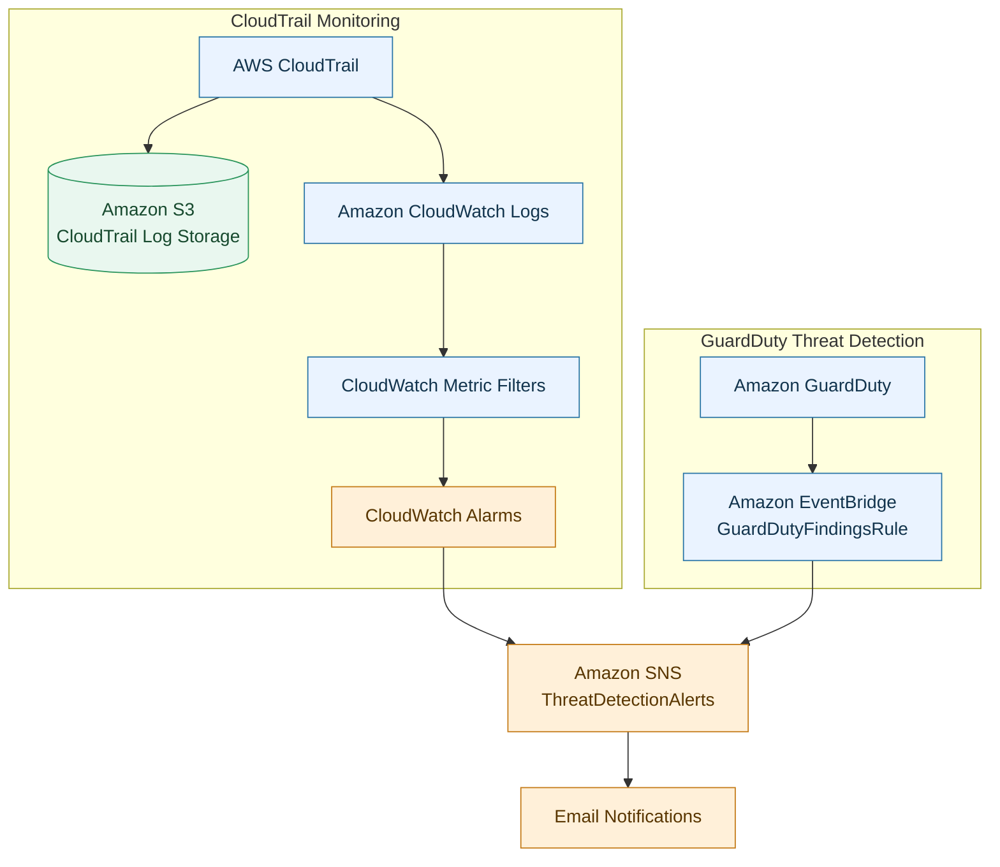

# AWS Threat Detection & Automated Security Alerting

## Project Overview

This project demonstrates how to build an AWS security monitoring and automated alerting solution using Amazon CloudTrail, Amazon GuardDuty, Amazon CloudWatch, Amazon EventBridge, and Amazon SNS.

The solution monitors AWS account activity, detects suspicious behavior and potentially unauthorized API activity, and automatically sends email notifications when security events or configured alarm thresholds are triggered.

The project was implemented using the AWS Management Console and AWS CLI through Windows PowerShell.

## Objectives

- Enable AWS CloudTrail to record AWS account activity.
- Configure Amazon GuardDuty to detect potential security threats.
- Integrate CloudTrail with Amazon CloudWatch Logs.
- Create CloudWatch metric filters to identify suspicious account activity.
- Configure CloudWatch alarms for security-related events.
- Set up Amazon SNS for automated email notifications.
- Configure Amazon EventBridge to forward GuardDuty findings to SNS.
- Validate the end-to-end security monitoring and alerting workflows.

## AWS Services Used

| AWS Service | Purpose |
|---|---|
| AWS CloudTrail | Records AWS account API activity and management events |
| Amazon S3 | Stores CloudTrail log files |
| Amazon GuardDuty | Detects potential security threats and suspicious activity |
| Amazon CloudWatch Logs | Centralizes and stores CloudTrail logs |
| Amazon CloudWatch Metric Filters | Identifies specific security-related events |
| Amazon CloudWatch Alarms | Monitors security metrics and triggers alerts |
| Amazon EventBridge | Routes GuardDuty findings to SNS |
| Amazon SNS | Delivers automated security notifications through email |
| AWS IAM | Manages permissions and service access |

## Architecture Diagram

The solution consists of two security monitoring and alerting workflows.

### 1. CloudTrail and CloudWatch Monitoring

CloudTrail records AWS management events and delivers them to CloudWatch Logs. Metric filters identify specific security-related activities, while CloudWatch alarms monitor the resulting metrics and publish notifications to SNS.

### 2. GuardDuty Threat Detection

GuardDuty generates security findings when suspicious activity is detected. EventBridge captures these findings and forwards them to the SNS topic for email notification.



## Implementation Details

### Exercise 1 – Configure AWS CloudTrail

- Created a multi-region CloudTrail trail named `aws-threat-detection-trail`.
- Configured an Amazon S3 bucket to store CloudTrail log files.
- Enabled management event logging for read and write operations.
- Enabled log file validation.
- Integrated CloudTrail with Amazon CloudWatch Logs.
- Verified that CloudTrail was actively logging and delivering events.

**Resources:**
- Trail: `aws-threat-detection-trail`
- S3 Bucket: `bryan-cloudtrail-logs-2026`
- CloudWatch Log Group: `/aws/cloudtrail/threat-detection`

### Exercise 2 – Enable Amazon GuardDuty

- Enabled Amazon GuardDuty in the Singapore region.
- Generated sample security findings for testing.
- Retrieved and reviewed GuardDuty findings.
- Verified that GuardDuty was generating security findings successfully.

### Exercise 3 – Configure Amazon CloudWatch Logs

- Integrated CloudTrail with the CloudWatch Logs service.
- Verified the existence of the CloudTrail log group and log streams.
- Retrieved CloudTrail events using CloudWatch Logs.
- Confirmed that AWS management events were successfully delivered to CloudWatch Logs.

### Exercise 4 – Configure CloudWatch Metric Filters and Alarms

Created three CloudWatch metric filters under the custom namespace `ThreatDetectionMetrics`.

| Metric Filter | Detection Purpose |
|---|---|
| `ConsoleLoginFailures` | Detects failed AWS Management Console login attempts |
| `UnauthorizedApiCalls` | Detects unauthorized or access-denied API requests |
| `IamPolicyChanges` | Detects IAM policy creation, modification, attachment, and deletion activities |

Configured corresponding CloudWatch alarms:

| Alarm Name | Metric | Evaluation Threshold |
|---|---|---|
| `Alarm-ConsoleLoginFailures` | ConsoleLoginFailures | Greater than or equal to 1 |
| `Alarm-UnauthorizedApiCalls` | UnauthorizedApiCalls | Greater than or equal to 1 |
| `Alarm-IamPolicyChanges` | IamPolicyChanges | Greater than or equal to 1 |

**Alarm Configuration:**
- Statistic: Sum
- Period: 300 seconds (5 minutes)
- Evaluation Periods: 1
- Missing Data Treatment: Not Breaching

### Exercise 5 – Configure Amazon SNS Email Notifications

- Created an SNS topic named `ThreatDetectionAlerts`.
- Configured an email subscription.
- Confirmed the email subscription.
- Connected all three CloudWatch alarms to the SNS topic.
- Published a test notification to verify email delivery.

**SNS Topic:** `ThreatDetectionAlerts`

**Result:** Successfully received the SNS test notification.

### Exercise 6 – Configure Amazon EventBridge for GuardDuty

- Created an EventBridge rule named `GuardDutyFindingsRule`.
- Configured the rule to capture GuardDuty findings.
- Used the following event pattern:

```json
{
  "source": ["aws.guardduty"],
  "detail-type": ["GuardDuty Finding"]
}
```

- Configured the existing SNS topic `ThreatDetectionAlerts` as the EventBridge target.
- Enabled the EventBridge rule.

### Exercise 7 – Security Testing and Validation

Performed validation to confirm that the monitoring and alerting workflows were functioning.

**Test 1: SNS Email Notification**

- Published a test message to the SNS topic.
- Successfully received the test email.

**Test 2: GuardDuty Finding Notification**

- Generated a GuardDuty sample finding.
- Used the finding type `Backdoor:EC2/DenialOfService.Tcp`.
- Verified that EventBridge captured the GuardDuty finding.
- Successfully received the finding notification through SNS.

**Test 3: CloudWatch Alarm Notification**

- Observed the `Alarm-IamPolicyChanges` alarm transition from `OK` to `ALARM`.
- The alarm reported a metric datapoint of `2.0`, exceeding the configured threshold of `1.0`.
- Successfully received the CloudWatch alarm notification through SNS.

**Validation Result:** Both the GuardDuty EventBridge notification workflow and CloudWatch alarm notification workflow successfully delivered email notifications.

## Security Monitoring Workflows

**Workflow 1 – AWS Account Activity Monitoring**

AWS CloudTrail → CloudWatch Logs → Metric Filters → CloudWatch Alarms → SNS → Email Notification

**Workflow 2 – GuardDuty Threat Detection**

Amazon GuardDuty → Amazon EventBridge → Amazon SNS → Email Notification

## Screenshots

The following screenshots document the AWS configuration and successful validation results.

### 1. CloudTrail Configuration
- CloudTrail trail configuration.
- Multi-region trail and management event settings.
- CloudTrail logging status.

### 2. GuardDuty Configuration
- GuardDuty detector enabled.
- GuardDuty sample findings.

### 3. CloudWatch Logs
- CloudWatch log group.
- CloudTrail log streams.
- Retrieved CloudTrail log events.

### 4. CloudWatch Metric Filters and Alarms
- Three configured metric filters.
- Three CloudWatch alarms.
- Alarm configuration and SNS actions.

### 5. SNS Email Notifications
- SNS topic configuration.
- Confirmed email subscription.
- Successful SNS test notification.

### 6. EventBridge Configuration
- EventBridge rule configuration.
- GuardDuty event pattern.
- SNS target configuration.

### 7. Security Testing and Validation
- GuardDuty sample finding.
- GuardDuty email notification.
- CloudWatch alarm notification.

## Key Learning Outcomes

Through this project, I gained practical experience in:

- Implementing AWS account activity monitoring using CloudTrail.
- Understanding threat detection capabilities using Amazon GuardDuty.
- Centralizing and analyzing AWS logs using CloudWatch Logs.
- Creating CloudWatch metric filters for security monitoring.
- Configuring CloudWatch alarms for automated security detection.
- Implementing SNS-based email notification workflows.
- Integrating GuardDuty with EventBridge for automated security alerting.
- Testing and validating AWS security monitoring and notification workflows.

## Cost Considerations

AWS services used in this project may incur charges depending on usage, configuration, and applicable free-tier eligibility.

Review AWS pricing before deploying the solution in a production environment. Monitor CloudTrail storage, CloudWatch Logs ingestion and retention, GuardDuty usage, and other enabled services.

## Disclaimer

This project was developed as a hands-on AWS cybersecurity lab for educational and portfolio purposes.

GuardDuty sample findings are simulated security events and do not represent actual security incidents or compromised AWS resources.

The solution demonstrates foundational security monitoring and alerting capabilities and is not intended to replace a complete enterprise Security Information and Event Management (SIEM) solution.
